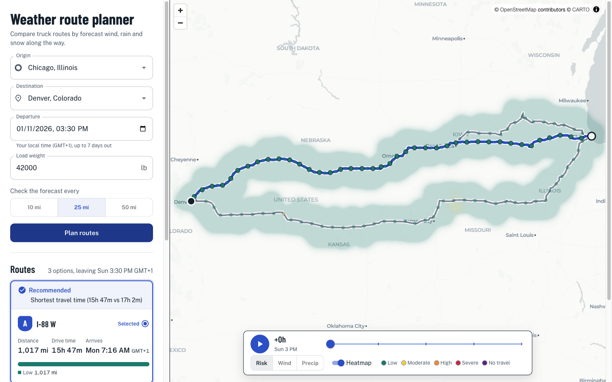

# Weather-aware truck routing

Enter an origin, a destination, a departure time and a load weight. The app fetches three route options and samples the forecast along each one at the hour the truck will reach each checkpoint. It scores every checkpoint with the spec's wind, rain and snow rules, adjusts wind for the load, and recommends a route. The map shows every route, its checkpoints and a 0–48 h weather heatmap along the corridor with an hourly slider.



Stack: React 19, MUI 9, MapLibre + deck.gl, TanStack Query and zod on the frontend; Django 6.1 + DRF on the backend. There is no database, because every request is computed from scratch.

## Quick start

Prerequisites: [uv](https://docs.astral.sh/uv/) (it installs Python 3.15) and Node 26 via [nvm](https://github.com/nvm-sh/nvm). You don't need Docker or any API keys.

Terminal 1, the backend on :8000:

```sh
cd backend
cp -n .env.example .env   # DEBUG=True; SECRET_KEY can stay empty in debug
uv run python manage.py runserver 8000
```

Terminal 2, the frontend on :5173 (Vite proxies `/api` to :8000, so CORS isn't involved):

```sh
cd frontend
source ~/.nvm/nvm.sh && nvm install 26 && nvm use 26
npm install
npm run dev
```

Open http://localhost:5173, pick Chicago and Denver, and press **Plan routes**.

## Deploy

The backend runs on [Render](https://render.com) and the frontend on [Vercel](https://vercel.com), both on free plans. Vercel rewrites `/api/*` to Render, so the browser only ever talks to one origin and CORS stays off, just as with the Vite proxy in development.

Backend on Render: **New → Blueprint**, pick the repo, and Render reads `render.yaml`. It builds `backend/` with `uv sync`, runs gunicorn, generates `SECRET_KEY`, and adds its own hostname to `ALLOWED_HOSTS` through `RENDER_EXTERNAL_HOSTNAME`. The region is Frankfurt because the routing servers are in Germany, so the backend's several upstream calls per plan stay short.

Frontend on Vercel: import the repo with root directory `frontend`. Vite and Node 26 are detected automatically. The rewrite in `frontend/vercel.json` points at this deployment's backend, `spotter-backend-toyq.onrender.com`. Render adds a random suffix to the service name, so a fresh deploy needs its own hostname there.

Free Render services sleep after 15 minutes without traffic and take about a minute to wake. Open the backend URL once before sharing the app.

## How it works

### Request flow

1. Place inputs call `GET /api/geocode?q=` (Photon, debounced, cached).
2. **Plan routes** sends one `POST /api/trips/plan` with origin, destination, departure, load and sample interval.
3. The backend fetches routes, samples checkpoints, makes one batched Open-Meteo call for checkpoints and heatmap cells, scores and ranks the routes, and returns everything in a single JSON response. That includes all 49 heatmap hours.
4. The frontend validates the response with zod, renders the route cards, and draws the map layers with deck.gl over MapLibre (CARTO basemap). The slider and metric toggle never call the API again.

Errors share one shape everywhere: `{"code": "upstream.weather_unavailable", "detail": "...", "fields"?: {...}}`. Field errors show inline on the form. Upstream 5xx and 429 errors get a Retry button.

### Providers

| Need | Provider | Why |
|---|---|---|
| Routing | Valhalla `truck` costing (FOSSGIS) | Real truck routing that follows truck road restrictions and takes the load weight. It returns up to two alternates. |
| | OSRM demo server | Fallback and top-up. Valhalla's public server rejects trips longer than roughly 1,500 km (930 mi) in a straight line, and some trips get fewer than 3 distinct alternates. |
| | OSRM via-point detours | When fewer than 3 distinct routes come back, the backend asks OSRM for routes through points offset ±12% perpendicular to the midpoint. It keeps a detour only if it is at most 35% longer than the original route. |
| Weather | Open-Meteo hourly forecast | Free, keyless, batches many locations per call, and has wind, gusts, rain and snowfall by the hour. |
| Geocoding | Photon (komoot) | Free, keyless, OSM-based autocomplete. |

All upstream URLs are fixed constants. User input only ever goes into query parameters or the JSON body.

### Checkpoints at ETA

Each route's geometry becomes a track of `(lat, lon, mile, seconds)` points. A checkpoint goes every 10, 25 or 50 mi (the user picks; 25 by default), plus one at the destination. Each checkpoint's ETA is the departure time plus the interpolated drive time to that mile, and it reads the forecast for that ETA, not for "now". Each checkpoint stands for the miles from the midpoint with its previous neighbour to the midpoint with its next one, so a route's per-tier miles add up to its length.

### Risk rules

From the spec:

| Condition | Low | Moderate | High | Severe | No Travel |
|---|---|---|---|---|---|
| Wind | <25 mph | 25–34 | 35–44 | 45–54 | ≥55 mph |
| Rain | <0.10 in/hr | 0.10–0.25 | 0.25–0.50 | 0.50–1.00 | >1.00 |
| Snow | <0.5 in/hr | 0.5–1.0 | 1.0–2.0 | 2.0–3.0 | >3.0 |

The spec's ranges overlap at their edges (0.25 appears in both Moderate and High) and skip the gaps between whole numbers (34 → 35 mph). The boundaries I use:

- Lower bound inclusive, upper bound exclusive: wind 34.9 is Moderate and 35.0 is High; rain 0.25 is High.
- Where the spec writes `>`, the top tier is strict: rain 1.00 is Severe and 1.01 is No Travel. The same goes for snow at 3.0.
- Wind is sustained 10 m wind. Gusts are shown in the tooltip but not scored.

### Load rules and ranking

Load rules only override the wind tier:

- ≥55 mph → No Travel for any load
- 45–54 mph and >30,000 lb → No Travel
- 35–44 mph and >40,000 lb → Severe

A checkpoint's level is `max(wind after load rules, rain, snow)`, scored low 0 … no_travel 4. Routes are sorted by:

1. Blocked: the route has any No Travel miles
2. No Travel miles
3. Severe miles
4. High miles
5. Average risk, weighted by miles
6. Travel time, in whole minutes

Steps 3–6 are the spec's order. I put No Travel first because a route through No Travel conditions shouldn't win on time. The top route is always recommended, along with the reason it beat the runner-up. If every route is blocked, a notice suggests delaying departure.

### Heatmap and slider

The backend builds a corridor of points every 10 mi along each route, plus ±20 mi to either side, snapped to the weather grid and capped at 250 cells. It returns risk, wind and precipitation for each cell for hours 0–48 in the same plan response.

Why the slider stays smooth:

- All 49 hours ship up front, so scrubbing never touches the network.
- The data stays stable. Each metric is flattened once into a `Float32Array` (hours × cells), and changing the hour only changes an offset into it.
- `getWeight` reads `values[hour * n + index]`, and `updateTriggers: { getWeight: [hour, metric] }` makes deck.gl recompute only the weights, not positions or layers.
- Hour and metric state live inside the map component, so scrubbing doesn't re-render the side panel. The map chunk is lazy-loaded.

When I measured it, a scrub step took about 10 ms at p95 and sent no `/api` requests.

## Decisions and trade-offs

**Risk and ranking**
- Wind tiers use sustained wind, not gusts. Gusts are shown but not scored.
- No Travel ranks above the spec's first criterion, and routes with any No Travel miles are flagged `blocked`.
- Each checkpoint owns the miles between the midpoints with its neighbours, so tier miles add up to the route length.
- Weather is read at the ceiling hour of the ETA. Open-Meteo's precipitation is the total for the hour *ending* at each timestamp.
- Missing or NaN weather fails the plan with a 502 instead of counting as Low.
- `precip_in_hr` in the heatmap is rain plus snow ÷ 10 (water equivalent). It is used for display only, never for scoring.

**Routing**
- The public Valhalla server rejects trips longer than roughly 930 mi (1,500 km) measured in a straight line between the endpoints; Chicago → Denver is 1,016 road miles and still gets truck routes. Longer trips fall back to OSRM car routes, and the app says so in a notice and on each card ("Car route").
- Synthetic via-point detours guarantee 3 options when the providers return fewer. They are real roads but not provider "alternatives".
- Routes over 3,500 mi are dropped to bound the cost of a request. If none are left, the API returns 422 `routing.too_long`.
- Route summaries name the roads that tell routes apart (each covering ≥25 mi, normalised like `I-80`), so the options don't all read "I-80".
- The entered load weight is sent as Valhalla's truck `weight` with no tare added, rounded down to the nearest 1,000 lb (minimum 1,000) so the route cache key matches the value sent. The same entered weight drives the load rules for risk.
- Two routes count as the same option when their distance and time are within 1% of each other, or when at least 90% of one route's points (every 10 mi) lie within a mile of the other. The faster one is kept, and the detour fill then looks for a genuinely different corridor.

**Weather budget**
- Every weather lookup snaps to a shared grid that starts at 0.25° (about 17 mi, roughly GFS resolution). If a trip needs more than 450 locations, the grid coarsens to 0.4° and then 0.5°. The response reports `weather_grid_deg`, and a notice explains the coarser grid. This keeps a New York → Los Angeles trip at 10 mi spacing under Open-Meteo's free-tier per-minute quota.
- Forecasts are cached for 30 minutes per grid cell. The plan endpoint is throttled to 6 requests per minute, and an upstream 429 maps to `upstream.weather_rate_limited`.

**Map**
- deck.gl runs in overlaid mode, not interleaved. deck 9.4.1's interleaved mode crashes with MapLibre 6, so routes and the heatmap draw above basemap labels.
- `HeatmapLayer` uses `weightsTextureSize: 512`, which removed roughly 250 ms GPU stalls on each hour change with no visible loss at the fitted zoom.
- Hover shows tooltips for mouse users. Touch and pen taps pin the tooltip, which stays anchored to its coordinate as the map moves.

**Tooling**
- TypeScript is pinned to 6.0.3 because typescript-eslint 8.72.1's peer range doesn't accept 7.x yet.
- CORS is off. The Vite proxy serves `/api` in development, so hosting the frontend on another origin would need it back.


## Testing

Backend, from the repo root:

```sh
cd backend
uv run pytest -q
uv run ruff check . && uv run ruff format --check .
```

Frontend, from the repo root:

```sh
cd frontend
source ~/.nvm/nvm.sh && nvm use 26
npm test
npm run lint && npm run build && npm run format:check
```

- Backend, 249 pytest tests: risk tiers at every boundary, load overrides, sampling and segment miles, ETA lookup, ranking order and reasons, corridor and grid selection, and the provider parsers and fallbacks (Valhalla 154 → OSRM, detours, geometry-based duplicate routes, malformed and 429 responses) against recorded fixtures with `respx`. Also the plan endpoint's validation, error shapes and throttling, with providers stubbed out.
- Frontend, 84 Vitest + Testing Library tests: form validation and the request payload, inline 400 errors (including mixed field and non-field errors), retry on 5xx, route cards, tooltip state (hover vs tap vs pen), heatmap grid building, slider playback, and formatting. A contract test parses `backend/tests/fixtures/plan_live.json`, a recorded live backend response, with the frontend's zod schema and fails on any field the schema doesn't know about.

## Project layout

```
backend/
  config/       settings, urls
  core/         error shape, HTTP client, geo + time helpers
  domain/       risk rules, sampling, corridor, ranking (pure functions)
  providers/    Valhalla/OSRM routing, Open-Meteo, Photon
  trips/        plan endpoint: serializer, service, heatmap, mapper
  geocoding/    geocode endpoint
  tests/        pytest suite + recorded fixtures
frontend/src/
  api/          fetch client, zod schemas, React Query hooks
  features/
    trip-form/  form + validation
    routes/     results panel, route cards
    map/        TripMap, deck.gl layers, tooltips, slider
  components/   shared MUI wrappers (RiskChip, RiskBar, …)
  lib/          risk colours, formatting, time
assets/screenshot.png
```
